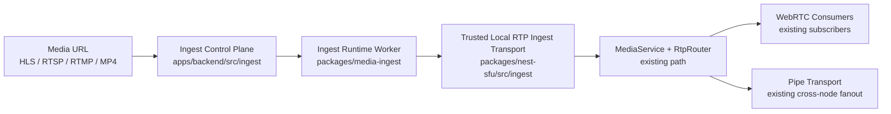

# Media URL Ingest Implementation Roadmap

This document defines the phase-by-phase implementation plan for adding production-grade media URL ingest to this SFU monorepo.

The goal is to let the platform pull a media source such as HLS, RTSP, RTMP, or MP4/VOD and rebroadcast it to normal WebRTC subscribers through the existing SFU pipeline.

This is an implementation roadmap, not a redesign proposal.

## Summary

The clean approach for this repo is:

- keep room, policy, audit, and operator control in `apps/backend`
- add a reusable ingest runtime package for FFmpeg/GStreamer supervision
- add a trusted local ingest transport in `packages/nest-sfu`
- reuse the existing producer, router, consumer, pipe, metrics, and distributed ownership paths

The ingest source should become a server-owned producer, not a second parallel media subsystem.

## Current Status

As of 2026-07-09, this roadmap is no longer purely prospective:

- ~~Phase 0 is implemented for shared contracts and backend persistence vocabulary~~
- ~~Phase 1 is implemented for the in-process `packages/nest-sfu` media path~~
- ~~Phase 2 is implemented for the admin/backend ingest control plane~~
- ~~Phase 3 is implemented for the reusable FFmpeg/FFprobe ingest runtime package~~
- ~~Phase 4 is implemented for single-node room lifecycle and producer registration~~
- ~~Phase 5 is implemented for owner-aware distributed ingest orchestration and existing pipe-path parity reuse~~
- ~~Phase 6 is implemented for secret-backed ingest auth resolution, lifecycle metrics, platform events, and auditability~~
- ~~Phase 7 is implemented for repo-local validation, restart/cleanup coverage, and rollout guardrails~~
- worker-mode live distributed ingest validation is still intentionally open and should be finished in the later distributed validation passes, not by redesigning the media stack

That means the repo already has:

- truthful shared ingest contracts and persistence vocabulary
- a truthful trusted local RTP/RTCP ingest entry point
- a truthful admin/backend ingest control plane
- a truthful reusable ingest runtime package with real FFmpeg/FFprobe supervision and local RTP/RTCP emission
- a truthful single-node room lifecycle that turns an attached ingest into a system participant plus normal producers
- a truthful owner-aware distributed control path so attached ingests start, stop, detach, and re-home through the authoritative room owner node

It does not yet have staged live browser truth across real deployment boundaries.

Completed roadmap items below are shown with strikethrough.

## Design Rules

These rules should hold through every phase:

- no architecture redesign
- no browser-side HLS or RTSP pull for subscribers
- no FFmpeg execution inside request handlers
- no reuse of the recording module as a live ingest transport
- no bypass around the existing producer and router model
- no cross-node ingest worker duplication; owner node remains authoritative

## Existing Seams To Reuse

The current codebase already has the right extension points:

- producer creation policy and persistence in `apps/backend/src/rooms/rooms.service.ts`
- producer signaling surface in `apps/backend/src/rooms/rooms.gateway.ts`
- producer registration in `packages/nest-sfu/src/media.service.ts`
- room ownership and distributed routing in `apps/backend/src/cluster`
- platform events in `apps/backend/src/events`
- audit logs in `apps/backend/src/audit-logs`
- operational metrics in `apps/backend/src/metrics`

The current producer model is WebRTC-first and currently limits `ProducerSource` to `'screen' | 'whiteboard'` in `packages/contracts/src/producers.ts`. That will need to expand.

## Target Architecture



## Proposed Package Layout

### New backend module

```text
apps/backend/src/ingest/
  ingest.module.ts
  ingest.controller.ts
  ingest.service.ts
  ingest-supervisor.service.ts
  ingest-policy.service.ts
  ingest.metrics.ts
  dto/
    create-ingest.dto.ts
    update-ingest.dto.ts
    attach-ingest.dto.ts
  schemas/
    ingest-job.schema.ts
  ingest.service.spec.ts
  ingest.controller.spec.ts
```

### New contracts

```text
packages/contracts/src/ingest.ts
```

### New reusable runtime package

```text
packages/media-ingest/
  package.json
  src/
    index.ts
    types.ts
    ffmpeg/
      ffmpeg-command-builder.ts
      ffprobe.ts
      ffmpeg-session.ts
    worker/
      ingest-runner.ts
      ingest-supervisor.ts
      process-health.ts
    metrics/
      ingest-runtime-metrics.ts
```

### New Nest SFU transport layer

```text
packages/nest-sfu/src/ingest/
  trusted-ingest-transport.ts
  ingest-transport.service.ts
  ingest-transport.types.ts
  ingest-transport.spec.ts
```

## Delivery Strategy

Build this in seven phases.

The first release target should be intentionally narrow:

- source types: MP4/VOD, then HLS
- codecs out: H264 video + Opus audio
- topology: owner-node only
- layers: single video layer, single audio track
- access: operator-controlled only

RTSP, RTMP, reconnect sophistication, and optional ladder generation should come after the first truthful vertical slice.

---

## Phase 0: Contracts, Data Model, and Vocabulary

### Goal

Add the ingest vocabulary to the shared contracts and persistence layer without changing room behavior yet.

### New contracts

~~Create `packages/contracts/src/ingest.ts` with:~~

- ~~`IngestSourceType = 'mp4' | 'hls' | 'rtsp' | 'rtmp'`~~
- ~~`IngestStatus = 'idle' | 'starting' | 'live' | 'restarting' | 'stopping' | 'stopped' | 'failed'`~~
- ~~`IngestTransportProtocol = 'trusted-rtp-local'`~~
- ~~`IngestRestartPolicy`~~
- ~~`IngestAuthConfig`~~
- ~~`IngestJob`~~
- ~~`IngestRuntimeState`~~
- ~~`CreateIngestRequest`~~
- ~~`UpdateIngestRequest`~~
- ~~`AttachIngestRequest`~~

~~Extend `packages/contracts/src/producers.ts`:~~

- ~~widen `ProducerSource`~~
- ~~add an ingest-aware source such as `'ingest'`~~
- ~~keep `ProducerKind` unchanged unless a later phase proves a new kind is necessary~~

~~Optional but recommended:~~

- ~~extend `packages/contracts/src/participants.ts` with a participant classification such as `origin?: 'user' | 'system'`~~

### Persistence work

~~Modify `apps/backend/src/database/schemas.ts`:~~

- ~~add `IngestJobDocument`~~
- ~~add indexes for:~~
  - ~~`roomId`~~
  - ~~`status`~~
  - ~~`nodeId`~~
  - ~~`participantId`~~
- ~~optionally add `origin` or `systemOwned` metadata to `ParticipantDocument`~~
- ~~widen `ProducerDocument.source` beyond `'screen' | 'whiteboard'`~~

### Current implementation status

Implemented in repo:

- `packages/contracts/src/ingest.ts` now defines:
  - source types
  - ingest statuses
  - trusted local ingest transport protocol vocabulary
  - restart policy and auth shapes
  - ingest job and runtime state shapes
  - create, update, and attach request contracts
- `packages/contracts/src/producers.ts` now widens `ProducerSource` to include `'ingest'`
- `packages/contracts/src/participants.ts` now exposes optional participant origin vocabulary with `origin?: 'user' | 'system'`
- `packages/contracts/src/index.ts` now exports the ingest contract surface
- `apps/backend/src/database/schemas.ts` now adds:
  - `ParticipantDocument.origin`
  - widened `ProducerDocument.source`
  - `IngestJobDocument`
  - indexes for `roomId`, `status`, `nodeId`, and `participantId`
- `apps/backend/src/database/database.module.ts` now registers the ingest job model

Validated in repo:

- contract serialization coverage in `packages/contracts/src/ingest.test.ts`
- backend schema coverage in `apps/backend/src/database/schemas.ingest.spec.ts`
- package build: `npm run build -w @native-sfu/contracts`
- package tests: `npm test -w @native-sfu/contracts`
- focused backend schema tests:
  - `npm test -w @native-sfu/backend -- --runInBand src/database/schemas.ingest.spec.ts`
- backend build: `npm run build -w @native-sfu/backend`

Intentional current boundary:

- Phase 0 adds vocabulary and persistence only
- it does not create ingest APIs, workers, transports, or room-level ingest behavior
- existing runtime room behavior remains unchanged

### Exit criteria

- ~~contracts compile~~
- ~~schema compiles~~
- ~~no runtime behavior change~~

Phase 0 status: complete

### Test gate

- ~~contract unit tests for normalization and typing~~
- ~~schema serialization tests~~

---

## Phase 1: Trusted Local RTP Ingest Transport

### Goal

Add a localhost-only ingest transport that can feed RTP and RTCP into the existing media pipeline without WebRTC handshake overhead.

### Why this phase exists

The current `MediaService` transport model is WebRTC-oriented. Ingest needs a trusted server-side path that:

- accepts RTP/RTCP locally
- does not require ICE
- does not require DTLS
- does not require SRTP
- still lands in the same router path used by existing producers

### New files

~~Add:~~

- ~~`packages/nest-sfu/src/ingest/trusted-ingest-transport.ts`~~
- ~~`packages/nest-sfu/src/ingest/ingest-transport.service.ts`~~
- ~~`packages/nest-sfu/src/ingest/ingest-transport.types.ts`~~
- ~~`packages/nest-sfu/src/ingest/ingest-transport.spec.ts`~~
- ~~`packages/nest-sfu/src/ingest/ingest-transport.integration.spec.ts`~~

### Existing files to modify

- ~~`packages/nest-sfu/src/index.ts`~~
- ~~`packages/nest-sfu/src/nest-sfu.module.ts`~~
- ~~`packages/nest-sfu/src/media.service.ts`~~

### Current implementation status

Implemented in repo:

- `TrustedIngestTransport` now binds localhost UDP RTP/RTCP sockets, tracks counters, rejects non-trusted sources, learns the remote endpoint, and returns RTCP to the publisher-side socket
- `IngestTransportService` now creates, registers, snapshots, and closes trusted ingest transports through the existing `MediaService` seam
- `MediaService` now exposes trusted-ingest hooks for:
  - transport registration and teardown
  - inbound RTP handoff into the normal routing path
  - inbound RTCP handoff into the existing RTCP processor path
- producer binding and producer registration now accept trusted ingest transport IDs without changing the existing WebRTC transport behavior
- Nest module exports are wired so the transport service can be consumed without introducing a parallel architecture

Validated in repo:

- unit coverage for loopback-only binding, learned RTCP egress, and explicit unsupported-mode failure
- integration coverage for:
  - trusted ingest RTP -> `MediaService` -> routed subscriber RTP delivery
  - subscriber-generated RTCP feedback -> trusted ingest transport -> publisher-side UDP socket
- package build: `npm run build -w @native-sfu/nest-sfu`
- focused transport tests: `npm test -w @native-sfu/nest-sfu -- ingest-transport.spec.ts ingest-transport.integration.spec.ts`

Intentional current limitation:

- worker-mode trusted ingest is not supported yet
- the service fails explicitly with `ServiceUnavailableException` when the active media controller does not expose the trusted-ingest hooks
- that boundary should remain explicit until worker/distributed ingest parity is implemented in later phases

### Implementation requirements

- localhost-only bind or explicitly configured private bind
- explicit transport lifecycle: create, bind, close
- RTP path to `RtpRouter.route(...)`
- RTCP path to existing RTCP handling
- packet counters and failure counters
- backpressure and queue protection
- clear rejection for non-local or unsupported senders

### Exit criteria

- ~~synthetic RTP packets can enter the router through the ingest transport~~
- ~~RTCP can flow back to the ingest transport~~
- ~~existing WebRTC transport path remains unchanged~~
- ~~in-process media path is complete; worker-mode parity remains a later-phase requirement~~

### Test gate

- ~~unit tests for packet acceptance and rejection~~
- ~~integration tests proving trusted ingest transport -> router -> consumer path~~
- ~~explicit regression proving unsupported worker-mode fails cleanly instead of silently degrading~~

---

## Phase 2: Backend Ingest Control Plane

### Goal

Add a backend-owned ingest domain that operators can control and rooms can attach to.

### New files

Add:

- ~~`apps/backend/src/ingest/ingest.module.ts`~~
- ~~`apps/backend/src/ingest/ingest.controller.ts`~~
- ~~`apps/backend/src/ingest/ingest.service.ts`~~
- ~~`apps/backend/src/ingest/ingest-supervisor.service.ts`~~
- ~~`apps/backend/src/ingest/ingest-policy.service.ts`~~
- ~~`apps/backend/src/ingest/dto/create-ingest.dto.ts`~~
- ~~`apps/backend/src/ingest/dto/update-ingest.dto.ts`~~
- ~~`apps/backend/src/ingest/dto/attach-ingest.dto.ts`~~
- `apps/backend/src/ingest/schemas/ingest-job.schema.ts`

### Existing files to modify

- ~~`apps/backend/src/app.module.ts`~~
- ~~`apps/backend/src/database/database.module.ts`~~
- ~~`apps/backend/src/database/schemas.ts`~~

### API surface

Recommended first endpoints:

- `POST /api/v1/ingests`
- `GET /api/v1/ingests/:id`
- `PATCH /api/v1/ingests/:id`
- `POST /api/v1/ingests/:id/start`
- `POST /api/v1/ingests/:id/stop`
- `POST /api/v1/rooms/:roomId/ingests/:id/attach`
- `POST /api/v1/rooms/:roomId/ingests/:id/detach`

### Current implementation status

Implemented in repo:

- `packages/contracts/src/ingest.ts` now includes admin control-plane list/query response types
- backend ingest control-plane module added with:
  - admin ingest CRUD
  - start and stop control-plane actions
  - room attach and detach control-plane actions
  - nested DTO validation for auth config and restart policy
  - source URL normalization and source-host allowlist support
  - explicit supervisor/service separation so runtime control can grow later without replacing the module
- `apps/backend/src/app.module.ts` now wires the ingest module into the backend

Implemented API surface in this repo uses existing backend admin conventions:

- `GET /api/v1/admin/ingests`
- `POST /api/v1/admin/ingests`
- `GET /api/v1/admin/ingests/:ingestId`
- `PATCH /api/v1/admin/ingests/:ingestId`
- `POST /api/v1/admin/ingests/:ingestId/start`
- `POST /api/v1/admin/ingests/:ingestId/stop`
- `POST /api/v1/admin/rooms/:roomId/ingests/:ingestId/attach`
- `POST /api/v1/admin/rooms/:roomId/ingests/:ingestId/detach`

Intentional architecture choice:

- the existing repo centralizes Mongoose schemas in `apps/backend/src/database/schemas.ts`
- because of that, `apps/backend/src/ingest/schemas/ingest-job.schema.ts` was intentionally not created
- the ingest job schema remains in the shared database schema registry rather than creating a parallel schema pattern

Validated in repo:

- service coverage in `apps/backend/src/ingest/ingest.service.spec.ts`
- controller and authorization metadata coverage in `apps/backend/src/ingest/ingest.controller.spec.ts`
- focused schema coverage in `apps/backend/src/database/schemas.ingest.spec.ts`
- package build: `npm run build -w @native-sfu/backend`
- focused backend tests:
  - `npm test -w @native-sfu/backend -- --runInBand src/ingest/ingest.service.spec.ts src/ingest/ingest.controller.spec.ts src/database/schemas.ingest.spec.ts`

Intentional current boundary:

- start/stop are control-plane state transitions only
- attach/detach persist room association only
- no ingest worker process is started in this phase
- no media packets flow in this phase

### Core rules

- ~~operator-only by default~~
- ~~URL allowlist support~~
- ~~secrets referenced indirectly or redacted~~
- ~~one active room attachment per ingest job for the first milestone~~
- ~~source type normalization on write~~

### Exit criteria

- ~~ingest jobs can be created, started, stopped, attached, and detached at the control-plane level~~
- ~~state is persisted cleanly~~
- ~~no actual media flow required yet~~

Phase 2 status: complete

### Test gate

- ~~controller tests~~
- ~~service tests~~
- ~~authorization tests~~
- ~~persistence tests~~

---

## Phase 3: Reusable Ingest Runtime Package

### Goal

Create the isolated runtime package that supervises FFmpeg or GStreamer and emits trusted RTP locally.

### New package

~~Add `packages/media-ingest/`.~~

### Responsibilities

- ~~source probing~~
- ~~source normalization~~
- ~~FFmpeg command building~~
- ~~process spawn and supervision~~
- ~~stdout/stderr capture~~
- ~~health heartbeat~~
- ~~restart policy~~
- ~~RTP egress to the trusted local ingest transport~~

### Current implementation status

Implemented in repo:

- `packages/media-ingest` now exists as an isolated workspace package with:
  - `src/types.ts`
  - `src/ffmpeg/ffmpeg-command-builder.ts`
  - `src/ffmpeg/ffprobe.ts`
  - `src/ffmpeg/ffmpeg-session.ts`
  - `src/worker/ingest-runner.ts`
  - `src/worker/ingest-supervisor.ts`
  - `src/worker/process-health.ts`
  - `src/metrics/ingest-runtime-metrics.ts`
- the runtime package now provides:
  - source probing through real `ffprobe`
  - source-aware FFmpeg input normalization for MP4, HLS, RTSP, and RTMP inputs
  - FFmpeg command building for the first safe H264 + Opus RTP output profile
  - isolated child-process supervision with restart/backoff policy
  - progress parsing, health tracking, and runtime metrics snapshots
  - real local RTP and RTCP emission to UDP targets
- the root workspace now registers `@native-sfu/media-ingest` as a first-class package

Validated in repo:

- unit coverage for command building in `packages/media-ingest/src/ffmpeg/ffmpeg-command-builder.spec.ts`
- unit coverage for probe parsing in `packages/media-ingest/src/ffmpeg/ffprobe.spec.ts`
- supervision/restart coverage in `packages/media-ingest/src/worker/ingest-supervisor.spec.ts`
- real FFmpeg/FFprobe integration coverage in `packages/media-ingest/src/worker/ingest-supervisor.integration.spec.ts`
- package build: `npm run build -w @native-sfu/media-ingest`
- focused package tests:
  - `npm test -w @native-sfu/media-ingest -- --runInBand src/ffmpeg/ffmpeg-command-builder.spec.ts src/ffmpeg/ffprobe.spec.ts src/worker/ingest-supervisor.spec.ts`
  - `npm test -w @native-sfu/media-ingest -- --runInBand src/worker/ingest-supervisor.integration.spec.ts`

Intentional current boundary:

- Phase 3 delivers the reusable ingest runtime package only
- it does not yet create room participants, producers, or SFU registration
- it does not yet attach the runtime to the backend ingest control plane
- that room-level lifecycle and media registration work remains Phase 4

### First codec and source profile

~~Start with one safe output profile:~~

- ~~video: H264 baseline/main profile as supported by target browsers~~
- ~~audio: Opus~~
- ~~packetization suitable for the trusted RTP ingest transport~~
- ~~single spatial layer~~
- ~~single audio stream~~

### Supported source order

Implement support in this order:

1. MP4/VOD URL
2. HLS
3. RTSP
4. RTMP pull or push

### Exit criteria

- ~~worker process can pull a real source and emit RTP/RTCP locally~~
- ~~crashes or restart loops are surfaced explicitly~~
- ~~worker isolation is real; backend process does not host decode/transcode work~~

Phase 3 status: complete

### Test gate

- ~~unit tests for command building and source normalization~~
- ~~process supervision tests with fake workers~~
- ~~integration tests with a local test clip or fixture~~

---

## Phase 4: Room and Producer Integration

### Goal

Make an ingest behave like a normal publisher inside a room.

### Existing files to modify

- ~~`apps/backend/src/ingest/ingest.module.ts`~~
- ~~`apps/backend/src/ingest/ingest.service.ts`~~
- ~~`apps/backend/src/rooms/rooms.service.ts`~~
- ~~`apps/backend/src/ingest/ingest.service.spec.ts`~~
- ~~`apps/backend/src/rooms/rooms.service.spec.ts`~~

### Core behavior

When an ingest is attached to a room:

- ~~create a synthetic participant~~
- ~~register one or more producers~~
- ~~bind those producers to the trusted ingest transport~~
- ~~route packets through the existing SFU path~~

### Important design choice

The ingest should be represented as:

- ~~a system participant~~
- ~~one or more normal producers~~

That keeps:

- ~~room state coherent~~
- ~~audit and events coherent~~
- ~~distributed proxying coherent at the single-node room boundary~~
- ~~subscriber-facing producer semantics unchanged~~

### First implementation target

One attached ingest creates:

- ~~one video producer~~
- ~~optionally one audio producer~~

The initial producer source should be identifiable as ingest-backed, but consumer logic should remain source-agnostic.

### Current implementation status

Implemented in repo:

- `IngestService.startAttachedRuntime()` now:
  - probes the source through the reusable ingest runtime package
  - creates a system participant through `RoomsService`
  - creates a trusted local ingest transport
  - creates normal audio/video producers bound to that transport
  - starts and supervises the ingest runtime
- `IngestService.stopAdminIngest()` and `detachAdminIngest()` now:
  - stop the ingest runtime
  - close the trusted transport
  - remove the ingest participant when the room is still open
  - clear persisted runtime identity safely
- `IngestService` now subscribes to `RoomsService.onRoomClosed()` so room close tears down attached ingest runtime state without redesigning room ownership
- `RoomsService` now exposes:
  - `createIngestParticipant()`
  - `createIngestProducer()`
  - `removeIngestParticipant()`
- ingest participants are persisted as `origin: 'system'`
- ingest producers are persisted as normal producers with `source: 'ingest'`
- room-close notification is now emitted from the existing room close paths so attached ingest cleanup can stay inside the current backend architecture

Validated in repo:

- focused backend compile check:
  - `npx tsc -p apps/backend/tsconfig.build.json --noEmit --pretty false`
- focused room and ingest lifecycle tests:
  - `npm test -w @native-sfu/backend -- --runInBand src/ingest/ingest.service.spec.ts src/rooms/rooms.service.spec.ts`

Intentional current boundary:

- Phase 4 is implemented for the backend single-node room/producer lifecycle
- distributed owner-node coordination and worker-mode parity remain Phase 5
- ingest secret resolution, lifecycle metrics, audit trails, and dedicated ingest platform events remain Phase 6
- browser/live subscriber truth and soak validation remain Phase 7

### Exit criteria

- subscribers can receive a live ingest stream exactly as they receive a browser-published stream
- existing room and consumer flows do not need separate ingest-specific subscription logic

### Test gate

- integration tests: ingest producer -> normal consumer
- room lifecycle tests
- producer close and detach cleanup tests

---

## Phase 5: Distributed Ownership and Pipe Parity

### Goal

Ensure ingest works correctly in distributed topologies and preserves parity with the existing pipe path while keeping the worker-mode rollout path intact.

### Existing files to modify

- ~~`apps/backend/src/ingest/ingest.service.ts`~~
- ~~`apps/backend/src/ingest/ingest.service.spec.ts`~~
- existing pipe/media modules validated through the normal producer/consumer path and did not require ingest-specific code changes in this pass

### Rules

- ~~only the owner node runs the ingest worker~~
- ~~non-owner nodes consume through existing distributed producer and pipe flows~~
- ~~no duplicate source pulling on multiple nodes during normal owner-aware control flow~~
- ~~ownership change re-homes the ingest worker through backend reconciliation without redesigning the room model~~

### Required behavior

- ~~attach/start on owner node, including remote-node control requests routed to the current owner~~
- ~~proxy to non-owner subscribers through the existing producer/pipe path~~
- ~~detach and cleanup across owner changes~~
- ~~close room teardown stops the ingest runtime~~

### Current implementation status

Implemented in repo:

- `IngestService` now consumes a dedicated durable ingest-coordination stream for owner-targeted:
  - start
  - stop
  - detach
  - ack
- room-attached ingest admin actions now:
  - resolve the current room owner
  - execute locally on the owner node, or
  - dispatch to the owner node and await an acked result
- `IngestService` now subscribes to room-owner events and reconciles attached ingests when ownership changes
- when ownership moves away from the local node:
  - the local ingest runtime stops
  - the trusted ingest transport closes
  - the synthetic participant is removed
  - the ingest status is preserved as `restarting` so the new owner can resume it
- when ownership becomes local again:
  - attached ingests in `starting` / `live` / `restarting` states resume on the new owner node
- no ingest-specific pipe transport changes were required because Phase 4 already made ingest producers look like normal producers, and the existing remote consumer feed / proxy producer path is source-agnostic

Validated in repo:

- focused distributed ingest lifecycle tests:
  - remote owner dispatch for attached ingest start
  - remote owner dispatch for attached ingest stop
  - remote owner dispatch for attached ingest detach
  - local runtime re-home on owner change
  - local resume on owner re-claim
  - ingest coordination listener registration on module init
- focused backend test run:
  - `npm test -w @native-sfu/backend -- --runInBand src/ingest/ingest.controller.spec.ts src/ingest/ingest.service.spec.ts src/rooms/rooms.service.spec.ts`

Intentional current boundary:

- Phase 5 is implemented for backend distributed ownership and existing pipe-path parity reuse
- broad worker-mode live media validation is still part of the later validation phases
- ingest security, metrics, audit trails, and platform events are implemented in Phase 6
- staged browser/live rollout proof remains Phase 7

### Exit criteria

- single-node and two-node behavior are aligned
- pipe cleanup converges
- owner-node handoff rules are explicit

### Test gate

- distributed integration tests
- worker-mode integration tests
- attach/detach churn tests

---

## Phase 6: Security, Metrics, Events, and Auditability

### Goal

Make ingest operationally safe and visible.

### Existing files modified

- `packages/contracts/src/events.ts`
- `apps/backend/src/ingest/ingest.service.ts`
- `apps/backend/src/ingest/ingest.module.ts`
- `apps/backend/src/ingest/ingest-policy.service.ts`
- `apps/backend/src/metrics/metrics.service.ts`
- `apps/backend/src/config/app.config.ts`
- `apps/backend/src/config/env.validation.ts`
- `docs/operator-runbook.md`
- `docs/deployment.md`
- `.env.example`

### Platform events

~~Add ingest lifecycle events such as:~~

- ~~`ingest.created`~~
- ~~`ingest.started`~~
- ~~`ingest.attached`~~
- ~~`ingest.restarting`~~
- ~~`ingest.failed`~~
- ~~`ingest.stopped`~~
- ~~`ingest.detached`~~

### Audit log actions

~~Record:~~

- ~~ingest create/update failures and successes~~
- ~~start/stop failures and successes~~
- ~~attach/detach failures and successes~~
- ~~policy/security rejection metadata~~

### Metrics

~~Add:~~

- ~~ingest jobs by state~~
- ~~ingest restarts~~
- ~~ingest failures by category~~
- ~~ingest input bitrate~~
- ~~ingest output bitrate and RTP packet rate~~
- ~~ingest runtime CPU and RSS if available~~
- ~~per-room active ingest count~~

### Security controls

~~Implement:~~

- ~~operator-only APIs~~
- ~~URL allowlist or denylist~~
- ~~secret/header redaction~~
- ~~no plaintext secret echo on read APIs~~
- ~~environment-backed secret reference resolution for runtime auth~~
- ~~local-only ingest media handoff by default~~

### Current implementation status

Implemented in repo:

- `packages/contracts/src/events.ts` now exports first-class ingest lifecycle event types and payloads
- `apps/backend/src/ingest/ingest.service.ts` now:
  - resolves runtime auth from environment-backed secret references
  - supports direct `env://VAR_NAME` and `env:VAR_NAME` refs
  - supports prefixed env lookups such as `vault://media/bearer` -> `INGEST_SECRET_VAULT_MEDIA_BEARER`
  - redacts configured secret refs from read responses
  - preserves masked secret refs on admin update round-trips
  - emits ingest lifecycle platform events for create, start, stop, attach, detach, restart, and failure paths
  - records operator audit rows for ingest lifecycle actions
  - refreshes ingest aggregate metrics and runtime bitrate/process gauges
- `apps/backend/src/metrics/metrics.service.ts` now registers ingest lifecycle, bitrate, restart, failure, packet-rate, and runtime resource metrics
- `apps/backend/src/ingest/ingest.module.ts` now imports the events, audit log, and metrics modules required by the Phase 6 vertical slice
- `apps/backend/src/config/app.config.ts` and `env.validation.ts` now expose ingest config for:
  - allowlisted source hosts
  - secret env prefix
  - private handoff policy
  - ingest runtime metrics persistence interval
  - ingest coordination timeout
  - explicit FFmpeg/FFprobe path overrides

Validated in repo:

- focused backend test run:
  - `npm test -w @native-sfu/backend -- --runInBand src/ingest/ingest.service.spec.ts src/metrics/metrics.service.spec.ts`
- backend build:
  - `npm run build -w @native-sfu/backend`
- shared contracts build and tests:
  - `npm run build -w @native-sfu/contracts`
  - `npm test -w @native-sfu/contracts`

### Exit criteria

- ~~ingest is observable and auditable~~
- ~~operator-facing failures are explicit~~
- ~~deployment docs state supported source and codec boundaries~~

~~Phase 6 status: complete~~

### Test gate

- ~~platform event tests~~
- ~~audit-backed lifecycle assertions~~
- ~~metrics assertions~~
- ~~secret redaction and secret-resolution tests~~

---

## Phase 7: Validation, Soak, and Rollout

### Goal

Prove the feature before broader release.

### Validation targets

- ~~one room, one ingest, one subscriber~~
- ~~one room, one ingest, multiple subscribers~~
- ~~room close during active ingest~~
- ~~source interruption and restart~~
- ~~runtime crash/restart cleanup through the FFmpeg supervisor path~~
- ~~distributed owner/non-owner subscription through the existing pipe path~~

### Browser truth targets

At least validate:

- ~~Chromium subscriber receives live ingest video~~
- ~~post-restart subscribed transport forwarding resumes after an interrupted-source restart~~

Optional after MVP:

- adaptive layer publication from ingest-generated ladders
- simulcast ladder generation from the ingest worker
- dynacast-aware ingest encoding suspension

### Rollout recommendation

Release in steps:

1. ~~hidden backend-only feature flag (`INGEST_ENABLED`)~~
2. ~~operator-only room attach~~
3. single-node production canary
4. two-node distributed canary
5. broader rollout after soak

### Exit criteria

- ~~no resource leaks after repeated start/stop and attach/detach~~
- ~~clean room close behavior~~
- ~~clear failure diagnostics~~
- ~~honest supported environment statement~~

### Test gate

- ~~unit tests~~
- ~~integration tests~~
- ~~browser subscriber validation~~
- ~~distributed pipe-path validation plus repeated cleanup loops~~

---

## File Inventory By Phase

### New files

- `docs/media-url-ingest-implementation-roadmap.md`
- `packages/contracts/src/ingest.ts`
- `packages/contracts/src/ingest.test.ts`
- `packages/media-ingest/**`
- `packages/nest-sfu/src/ingest/**`
- `apps/backend/src/ingest/**`
- `apps/backend/src/database/schemas.ingest.spec.ts`

### Existing files likely to change

- `apps/backend/src/app.module.ts`
- `apps/backend/src/database/database.module.ts`
- `apps/backend/src/database/schemas.ts`
- `apps/backend/src/rooms/rooms.module.ts`
- `apps/backend/src/rooms/rooms.service.ts`
- `apps/backend/src/events/platform-events.service.ts`
- `apps/backend/src/metrics/metrics.service.ts`
- `apps/backend/src/audit-logs/audit-logs.service.ts`
- `packages/contracts/src/producers.ts`
- `packages/contracts/src/participants.ts`
- `packages/contracts/src/events.ts`
- `packages/contracts/src/index.ts`
- `packages/nest-sfu/src/index.ts`
- `packages/nest-sfu/src/nest-sfu.module.ts`
- `packages/nest-sfu/src/media.service.ts`

## Out Of Scope For The First Implementation

These should not block the first truthful release:

- AV1 ingest
- SVC-native ingest production
- per-layer ingest dynacast pause/resume
- recording and ingest unification
- cloud DVR
- CDN playout
- browser-side source URL playback as a fallback transport

## Recommended First Milestone

The first real milestone should deliver this vertical slice:

- operator creates an ingest job
- ingest worker pulls an MP4 or HLS source
- worker emits H264 + Opus RTP locally
- trusted ingest transport accepts packets
- ingest registers as a system participant with normal producers
- a room subscriber receives the live stream
- metrics, platform events, and audit logs reflect the lifecycle

If that slice is stable, the rest of the roadmap becomes additive instead of speculative.

## Phase Tracking Summary

- ~~Phase 0: implemented for contracts and backend persistence vocabulary~~
- ~~Phase 1: implemented for the in-process `packages/nest-sfu` path~~
- ~~Phase 2: implemented for the admin/backend control plane~~
- ~~Phase 3: implemented for the reusable FFmpeg/FFprobe runtime package~~
- ~~Phase 4: implemented for single-node room lifecycle and producer registration~~
- ~~Phase 5: implemented for owner-aware distributed orchestration and existing pipe-path parity reuse~~
- ~~Phase 6: implemented for security, metrics, events, and auditability~~
- ~~Phase 7: implemented for validation, soak, and rollout guardrails~~
